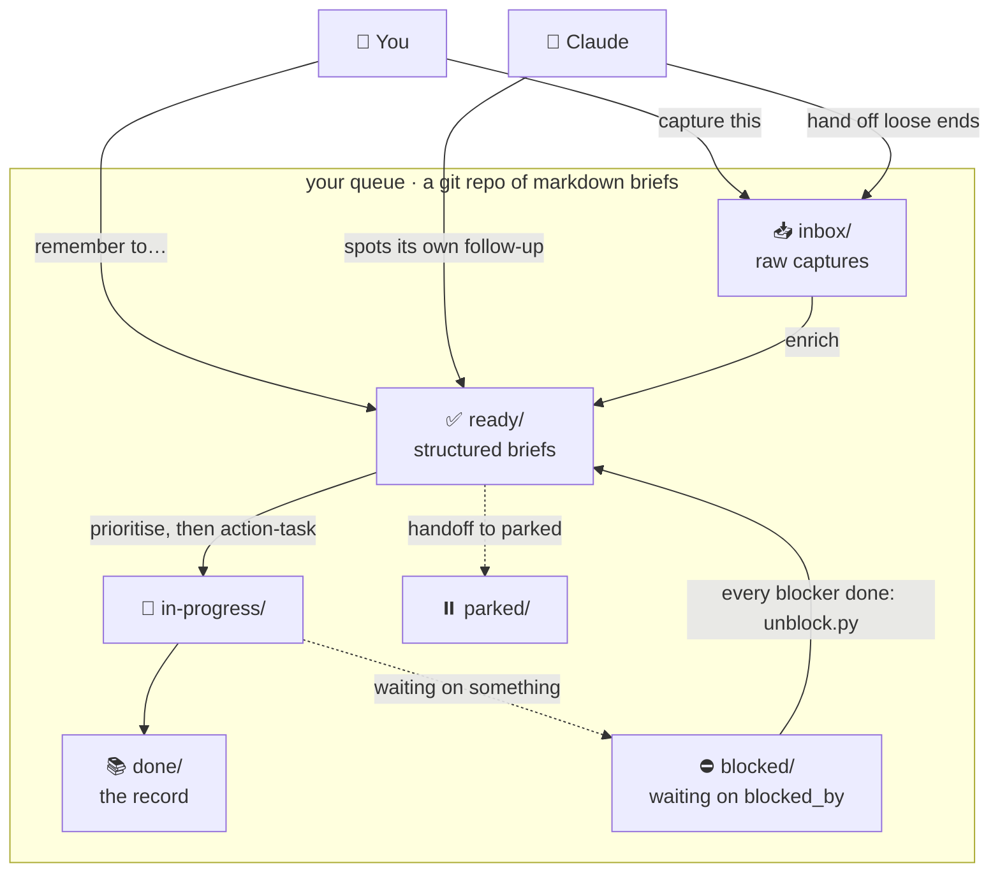

# claude-tasks

A **git-backed task queue that Claude can capture into, structure, see, execute, and hand
off.** Each task is a self-contained markdown *brief* — rich enough that an agent can act
on it with zero prior context.

Installed as a [Claude Code](https://claude.com/claude-code) plugin. Your queue is a plain
git repo of markdown files: greppable, diffable, syncable, and yours.

> Status: **v1**. The core capture → structure → see → execute → hand-off loop is here,
> fully tested. See [Roadmap](#roadmap) for what's deliberately deferred.

## How it works

For how the queue reaches GitHub (writers, the 60-second sweep, merges and parking), see [docs/queue-sync.md](docs/queue-sync.md).

Two actors, one queue: you drop ideas in, Claude works the ones it can and hands its loose
ends back. Everything is plain markdown moving between folders:



A brief only moves forward when it's earned it: raw notes get **enriched** into briefs,
the **prioritiser** picks the highest-leverage *unblocked* brief, **action-task** runs it,
and finished briefs stay in `done/` as the record — where they can **unblock** whatever was
waiting on them. A concrete run-through is in [A worked example](#a-worked-example) below.

## Why briefs, not to-dos

Most task tools store a title and a due date — too thin for an agent to act on. The unit
here is a **brief**:

- **Goal** — the desired end state ("X exists / Y is true"), not "do X".
- **Context** — everything a zero-context agent needs: repos, paths, links, why.
- **Success criteria** — the checkable contract for "done".
- plus constraints, notes, and an execution log.

Two actors share one queue: you drop ideas in; Claude captures its own follow-ups,
enriches raw notes into briefs, executes the ones it can do end-to-end, and hands a
session's loose ends back when it stops.

## Install

```
/plugin marketplace add <owner>/claude-tasks
/plugin install claude-tasks
```

(Or point your plugin config at this repo.) Then create your queue:

```
/tasks-init ~/tasks --name "My Queue"
```

That scaffolds the lifecycle folders, a `tasks.toml`, and a brief template, and tells you
how the scripts will find it.

The scripts require **Python 3.11+**. On macOS the system `python3` is 3.9; if a script
is run with it, it exits with a message telling you which interpreters to use instead
(rather than the cryptic import-time `TypeError` older Pythons would otherwise raise).

## The loop

| You say… | Skill | What happens |
|---|---|---|
| "remember to…" / Claude spots a follow-up | **queue-task** | a full brief is minted |
| "capture this" (mid-flow) | **raw-capture** | a raw note lands in `inbox/` |
| "enrich the inbox" | **enrich** | raw notes become structured briefs |
| "what's next?" / `/tasks-next` | **prioritise** | ranks the queue (dependency-aware) |
| "start a session on X" / `/start` | `start_prompt.py` | prints a session-start prompt for a project, milestone or tag slice; alone, the menu of slices |
| "action the X task" | **action-task** | Claude executes a brief end-to-end |
| "show the board" / `/tasks-board` | — | regenerates `view/board.html` |
| "I'm done, hand off" | **handoff** | the session's open work flows to the queue |
| "recap" | **recap** | a quick in-chat status summary |
| "how are my projects going?" / "portfolio status" | **rollup** | a read-only project roll-up at three levels (work: ranked ready briefs, bugs and uncovered requirements; project: project tiles, a milestone table and collapsed detail; portfolio: projects by initiative, one sentence and a line per milestone), read from each project's queue on its GitHub default branch (`--source LABEL=REPO[#QUEUE]`, `--level work\|project\|portfolio`; each view is HTML, Markdown and JSON, and JSON milestones carry `waiting`, projects carry `as_at`); Claude Code and the Desktop Code tab generate it, Desktop Chat and claude.ai read the published files |

### Priorities and dependencies

`rank.py --scope all|tag:<t>,...|project:<slug>|milestone:<id>,...|session:<id>|ids:<slug>,... --top K` reorders the unblocked
candidates against your own taste profile (`profile/priorities.md`, drafted by `seed_profile.py`)
with a one-line reason each. It learns from what you pick, bump and skip (`learn.py` proposes the
weight changes). See [the design notes](docs/design.md#the-predictor-head-ranking-against-a-taste-profile).

`prioritise` (the `/tasks-next` command) ranks `ready/` briefs by due urgency, importance,
quick-win effort, lead time, and — crucially — how many other briefs each one **unblocks**.
Dependencies are declared with `blockers: [other-id]` or a `depends:<id>` tag, and a brief
stays blocked until its dependency reaches `done/`, so the queue self-unblocks as work
lands. Define your own priority-tag weights (e.g. an `urgent`/`frog` convention) under
`[priority]` in `tasks.toml`; the base ranking is otherwise purely mechanical.

### Starting a session on a slice

`/start` (`scripts/start_prompt.py`) prints a prompt to paste into a new session: the slice's ready
briefs in priority order, each as an `/action-task` command, with what is held in `in-progress/`
or `blocked/` counted beneath. It reads the current queue and every initialised queue in
`$CLAUDE_TASKS_ROOTS`, a PATH-style list.

```
/start                                  # the menu: each queue's ready briefs by milestone and tag
/start checkout                         # one project, in priority order
/start checkout --milestone m1,m2       # milestones m1 and m2 of that project
/start sp --tag ux                      # sp: search-platform, by initials
/start all --tag memory                 # one tag across every queue
```

A milestone needs one project; values in one flag take any of them, and `--milestone` with
`--tag` takes briefs matching both. A clone behind its origin is warned about once, naming the
queues it holds.

### Logging without writing the main checkout

```
python scripts/append_log.py <id> "what happened"
```

Appends a dated line to the brief's Execution log from a temporary worktree off `origin/main`,
commits, pushes and removes the worktree. Use it where writes to the queue's main checkout are
blocked (a subagent); `transition.py move --log` remains the way to log a state change.

### Blocked state, dependency check, optional milestones

A brief that cannot proceed moves to `blocked/` with what it waits for:

```
python scripts/transition.py move <id> blocked --blocked-by other-id,external:vendor reply
```

`blocked_by` lists brief ids, `external:<reason>` entries (a login, a decision, a
vendor; reasons may not contain commas) and `date:YYYY-MM-DD` entries ("leave it until that
day": unmet before it, met on it). When every id is `done` and no external entry
remains, `unblock.py` returns the brief to `ready/` with `blocked_by` cleared, releasing
several at once in priority order. It runs automatically after `transition.py move <id>
done`, and can be run any time (`--dry-run` to preview). An external blocker is cleared by
hand once true: `python scripts/unblock.py resolve <id> "vendor reply"` (`--dry-run` previews it without writing).
A brief whose last external blocker is cleared while ids or `depends:` tags are still open stays in
`blocked/` and is released automatically once they are done.

#### How a dependency travels

Every brief declares its dependencies when filed: `add_task.py --blocked-by <id|external:reason>`,
or `--no-deps` for `blocked_by: []`. A brief in another queue is named `<queue>:<id>`, where
`<queue>` is a queue's folder name (or the project folder holding a `.tasks`) among the roots
listed in `$CLAUDE_TASKS_ROOTS`, separated like `PATH`.

```
  tasks/blocked/B.md                           web/.tasks/ready/C.md
  blocked_by: [A, web:C, external:vendor]      blocked_by: []
        │          │         │
        │          │         └── cleared by hand: unblock.py resolve B "vendor"
        │          └── C done in web ──┐
        └── A done here ───────────────┤
                                       ▼
            transition.py move <id> done
              1. cascade: each dependent's log gets
                   landed: A done: <shipped line> [<sha or PR links>]
                   landed: web:C done: ...            (other queue: prefixed)
                 and, if its prose still says "after A merges":
                   stale prose: says "after A merges" but A is done; update the plan
              2. unblock: B moves to ready/ once A and web:C are done and no external: entry remains
                   unblocked B → ready
              3. picker: prints next: with the top runnable brief in ready/
```

A date works the same way with no completion to wait for: `blocked_by: [date:2026-12-01]` is
unmet until 1 December, and the daily `unblock.py` sweep over every root in
`$CLAUDE_TASKS_ROOTS` moves the brief to `ready/` that morning, logging
`unblocked: date:2026-12-01 done`. Parking is only for an explicit "park it"; a wait is always a
dependency.

Worked example: `B` waits on `A`, `web:C` and a vendor reply. `A` goes done first, so `B` logs
`landed: A done: …` and stays blocked. The vendor replies (`unblock.py resolve`). `C` goes done in
the `web` queue, so `B` logs `landed: web:C done: …`, moves to `ready/`, and the picker names the
next brief.

Raise a brief's importance from any session with `bump.py`; it only raises, and records the
reason and time in a `## Bump` section of the brief:

```
python scripts/bump.py <ref> --importance 1 --reason "why it matters now"
```

`<ref>` is a brief id, or `<repo>#<n>` for a brief tagged `pr:<repo>#<n>` (the PR queue). The PR
queue also writes `blocked_by: [owner/repo#n, split]` on PR briefs; those entries are not brief
ids, are re-evaluated on every sync, and clear when the PR they name merges.

`python scripts/check_deps.py` lints the graph and exits 1 on: dependency **cycles**,
**dangling** ids, **in-progress** briefs with unmet dependencies, blocked briefs with no
reason, and blocked briefs that are already releasable. `blockers:` and `depends:<id>`
keep working and take part in all of it.

**Milestones are optional and owned by the project, not the queue.** Set
`milestones = "docs/milestones.toml"` in `tasks.toml` (path relative to the directory
holding the queue) and a brief's `milestone:` is validated against that file and the board
shows progress per milestone. The only contract with the file is that the keys of its
`[milestone]` table are the ids, in display order, each with an optional `title` and an
optional `release` (the release it ships in, shown beside the milestone; absent means unset);
every other field is the project's. A queue without the setting behaves exactly as before.
`python scripts/milestones.py progress --json` prints the counts.

A brief's membership of a milestone is stored in one place, its own `milestone: <id>`
frontmatter, and every count and the project page derive from it. The `[[milestones]]` tables of
a queue's `project.toml` take the same `release` key and no longer take a `briefs` list; an old
one is ignored.

### Sharing a queue: claiming with `assignee`

A queue can be shared by several people and agents. Because briefs are files in git, two
of them can pick the same brief and neither sees the other's move until someone pushes.
The optional `assignee:` field plus one convention keeps that cheap to avoid:

```yaml
assignee: alice        # a person, an agent name, a machine — free-form
assignee:              # empty = unclaimed
```

**The claiming convention.** Before starting work on a brief:

1. `git pull` — get everyone else's claims first.
2. Claim it and move it, in one step:
   ```
   python3 scripts/transition.py move <id> in-progress --assignee alice --log "started"
   ```
3. That commits **the claim alone** and pushes it in the background straight away, before
   any of the actual work.

The point of step 3 is that your claim becomes visible to everyone else in seconds rather
than whenever your first real commit happens to land. Later transitions leave the claim
alone unless you pass `--assignee` again.

**Claiming will not silently steal someone else's claim.** If a brief is already claimed by
someone other than the assignee you pass, the move is refused and nothing is written:

```
$ python3 scripts/transition.py move <id> in-progress --assignee bob
error: '<id>' is already claimed by 'alice'; refusing to reassign it to 'bob'.
       Coordinate with them, or release it first with --assignee "".
```

Re-claiming with the same assignee is fine (idempotent), and claiming an unclaimed brief is
fine. To free a brief stuck under a stale claim, release it with `--assignee ""` — releasing
is deliberately allowed regardless of who holds it. `--assignee` takes a single-line value;
a newline in it is rejected rather than written into the frontmatter.

`assignee` is **advisory, not a lock**. Within a single checkout, `transition.py` really does
serialise concurrent moves on a file lock, so two local processes cannot both move the same
brief, and the claim check happens under that same lock so two local sessions cannot both
claim it. What it cannot do is coordinate *across* clones: pulling first narrows the race
window, it does not close it, and two people who claim on separate machines within the same
few seconds will still collide (the background push logs it and your next queue write prints it, and
you sort it out between you).
Treat it as a coordination signal, not a mutex. Briefs without the field are simply
unclaimed; the board shows a claimed brief with an assignee chip and matches it in search.

## A worked example

Say you're mid-way through a code review and notice the public API has no rate limiting.
You don't want to lose the thought, but you don't want to stop either:

> **You:** capture this — the public API has no rate limiting

`raw-capture` drops a one-line note in `inbox/` and you carry on. Later you clear the inbox:

> **You:** enrich the inbox

`enrich` turns that note into a full brief in `ready/`:

```markdown
---
id: add-rate-limiting-to-public-api
title: Add rate limiting to the public API
status: ready
type: todo
importance: 2
autonomy: full
due: 2026-07-01
blockers: [choose-rate-limit-store]
tags: [security, depends:choose-rate-limit-store]
---

## Goal
The public API rejects abusive traffic: each client is capped at N requests/minute
and over-limit requests get a clear 429.

## Context
`api/routes/*` currently have no throttle. We need a shared counter store first —
tracked by the `choose-rate-limit-store` brief.

## Success criteria
- [ ] Over-limit requests return 429 with a `Retry-After` header
- [ ] The limit is configurable per route
- [ ] Covered by tests
```

Then you ask what to pick up next:

> **You:** what's next?  *(or `/tasks-next`)*

`prioritise` ranks `ready/` — but this brief is **held back**, because its blocker
`choose-rate-limit-store` isn't in `done/` yet. The prioritiser is dependency-aware, so it
surfaces the store-choice brief instead. Once that lands in `done/`, the rate-limiting brief
**self-unblocks** and rises to the top (a security item near its due date). Now:

> **You:** action the rate-limiting task

`action-task` moves it to `in-progress/`, Claude works it end-to-end against the success
criteria, and it finishes in `done/` — where it stays as the record, and where its
completion is what unblocked anything waiting on *it*.

## The queue

```
inbox/        raw, un-enriched captures (pre-briefs)
ready/        enriched, executable briefs
in-progress/  briefs being worked
blocked/      briefs waiting on `blocked_by` (released by unblock.py)
done/         completed briefs (kept — they are the record)
parked/       suspended briefs
view/         generated board.html (read-only; never hand-edited)
tasks.toml    per-queue config (name, domains, timezone)
_template.md  the brief schema
```

A brief's `status:` always matches its folder. The board is a *view*, regenerated from the
briefs — the briefs are the source of truth.

### Where the queue lives (root resolution)

The scripts ship in the plugin; your queue is your data, elsewhere. The root is resolved
in order:

1. `$CLAUDE_TASKS_DIR`, if set — a global personal queue.
2. The nearest ancestor `.tasks/` directory (walk up, like git's `.git`) — project-scoped
   queues you can check into a repo.
3. `~/tasks` — the default.

## Project facts

A queue that backs a project page keeps its facts beside its briefs. Every fact that changes over
time is a small file that is only ever added, so two writers never conflict and the history is the
audit trail. The current value, the slip and the staleness are derived on every read and never
stored. [`project_facts.py`](#recording-a-fact-project_factspy) is the one writer, and `action-task`
calls its `set-shipped` when a brief moves to `done/`.

```
project.toml                        baseline: title, outcome, milestones, optional keys below
history/health/<date>-<8 hex>.toml  colour, reason, set_by, set_on
history/due/<milestone>-<date>-<8 hex>.toml   milestone, due, set_on, set_by, reason
history/ci/<date>-<8 hex>.toml      state (green or red), link, set_on
facts/<brief>.toml                  flags, evidence, shipped, shipped_on, release
```

**`project.toml`** holds the baseline. Its optional keys are `initiative` (one line naming the
programme the project belongs to), `[links]` (`name = "https://..."`), `[[releases]]` (`id`, `date`)
and `[ask]` (one table: the question the owner needs answered). A milestone's `due` is the first
date promised; each row in `history/due/` re-forecasts it, the newest row is the current date, and
the slip is the current date minus the first one. A forecast one day past the first date is a slip
of one day, with no grace.

**Health** is the newest row in `history/health/`. The owner's statement is stale after 7 days:
a row set 6 days ago is fresh, a row set 7 days ago is reported as not reconfirmed.

**`facts/<brief>.toml`** names its brief (`brief = "<id>"`) and holds:

- `[[flag]]`: `name`, `environment`, `state`, `changed_on`; the newest row per name and environment
  is the current state.
- `[[evidence]]`: `kind` (`screenshot` or `video`), `link` (https), `caption`,
  `access` (`public`, `org` or `private`), `recorded_on`.
- `shipped` (one line), `shipped_on` and `release` (an id from `[[releases]]`).

**Brief frontmatter** names the project structure a brief belongs to: `milestone`, `architecture`
(the id of an `[[architecture]]` node), and `evidence: required` for a brief that cannot count as
done without recorded evidence (moving it to `done/` without any prints a warning; it never
blocks).

A row or file that cannot be read is skipped with one warning on stderr naming it. The older shapes
still read: a `briefs = [...]` list on a milestone or architecture node and a `[health]` table in
`project.toml` (read as the oldest health row, with no date required). The lists warn that they are
deprecated; give each brief `milestone:` or `architecture:` instead.

### Recording a fact: `project_facts.py`

```
python3 scripts/project_facts.py --root <queue-dir> <subcommand> [options]
```

| Subcommand | Records |
|---|---|
| `set-health --colour green\|amber\|red --reason <text> --set-by <name> [--on <date>]` | a health row |
| `set-due --milestone <id> --due <date> --reason <text> --set-by <name> [--on <date>]` | a due-date re-forecast |
| `set-ask --text <question>` or `set-ask --clear` | the project's `[ask]` |
| `set-flag --brief <id> --name <flag> --environment <env> --state on\|off [--changed-on <date>]` | a flag row |
| `add-evidence --brief <id> --kind screenshot\|video --link <https url> --caption <text> --access public\|org\|private [--recorded-on <date>]` | an evidence row |
| `set-shipped --brief <id> --line <text> [--on <date>] [--release <id>]` | what shipped |
| `set-ci --state green\|red --link <https url> [--on <date>]` | a CI reading |

Dates are `YYYY-MM-DD` and default to today. The write and its commit happen inside one hold of the
queue lock. Exit codes: `0` recorded; `1` an argument or an existing file failed validation, with
one line on stderr naming it; `2` the queue lock was not acquired in time and nothing was written.

## Configuration

Everything user-specific is a *value*, not code. `tasks.toml` at the queue root:

```toml
name = "My Queue"           # shown in the board title
domains = ["work", "home"]  # the allowed set for a brief's `domain:`
timezone = "UTC"
# milestones = "docs/milestones.toml"   # optional, project-owned; see Blocked state above

[triage]                    # optional; what the scheduled inbox triage may move out of the queue
stale_days = 21             # a needs-info inbox brief idle longer than this raises an alert
max_moves = 200             # most briefs one run closes; 0 turns closing off
```

Triage moves briefs, never deletes them. A brief whose own evidence says it is finished (every referenced
PR merged or closed and named as the deliverable, or every success criterion ticked) goes to `done/` with
`closed_reason` set, and so does a duplicate once its body is appended to the surviving brief. Judgement
never moves a brief: a stale needs-info brief or a model-called drop stays put and is raised in one
aggregated alert per run, then again only after `stale_days` more. Each move is one line in `closed.jsonl`
in the queue, and `python3 scripts/triage.py reopen <id>` puts the brief back in its folder, clears its closing fields and
marks it `reopened` so triage leaves it alone.
`python3 scripts/triage.py promote --dry-run` prints the planned moves and alerts without writing anything.

The engine (scripts, skills, board) is identical for everyone; only the config differs.

## Quality

Every change is gated in CI, blocking:

- **ruff** — lint
- **mypy --strict** — full static typing
- **pytest** with a **100%-coverage gate** on our own code
- **mutmut** — mutation testing on the resolution/config core (zero surviving mutants)

Line coverage proves code ran; mutation score proves the tests actually assert behaviour.

## Roadmap

Deliberately not in v1, designed to bolt on without changing the engine:

- **SessionEnd auto-capture** — a deterministic hook that parses the session transcript
  for open Task-API/TodoWrite items and files them (idempotent via a marker). Today the
  `handoff` skill does this model-driven, on demand.
- **session-browser** — browse/resume recent sessions; render one session as a board.
- **Leverage prioritisation** — the generic, mechanical prioritiser ships in v1
  (`prioritise`); a richer whole-estate ranking by a configurable leverage score
  (emotional weight × reduces-load × urgency × compounding) is the deferred personal variant.
- **External routing** — push real-world tasks to another task system.
- **Autonomous worker** — a scheduled loop that drains the `autonomy: full` queue.

## License

MIT — see [LICENSE](LICENSE).
