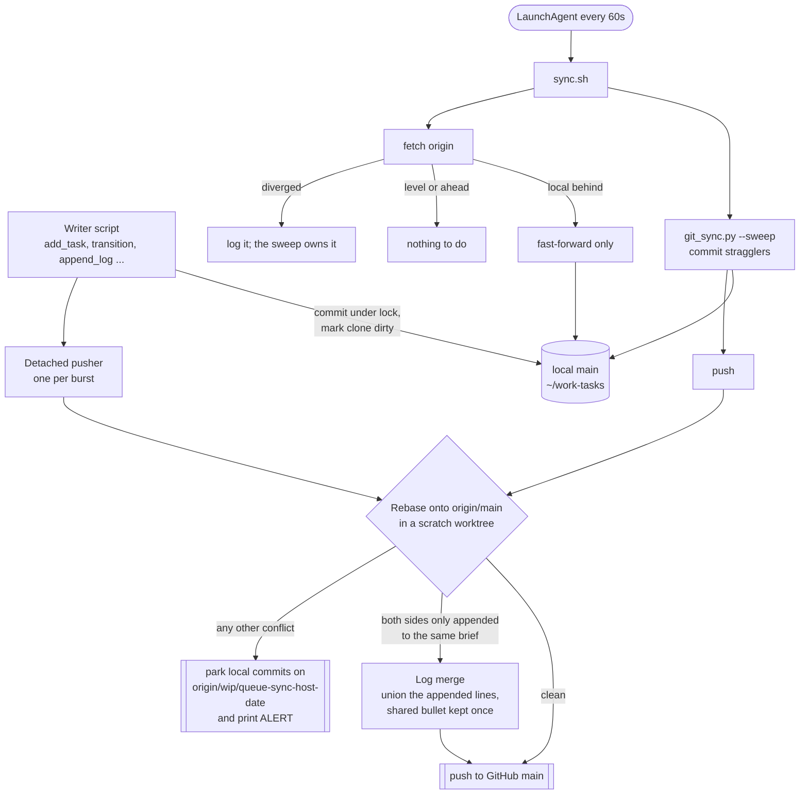

# How the work queue syncs

The queue (`~/work-tasks`) is a git repo, and GitHub `main` is the shared copy. Changes reach it in two ways:

- **On every write.** Every script that changes a brief (`add_task`, `transition`, `append_log`, `bump`, `unblock` and the rest) commits straight away under a cross-process lock and marks the clone dirty. One background pusher per clone then pushes the whole burst once.
- **Every 60 seconds, as a safety net.** The LaunchAgent `com.katherine.work-tasks-sync` runs `sync.sh`. It first runs `git_sync.py --sweep`, which commits anything no writer named and pushes it, then catches the local checkout up.

The plugin's own code (this repo, cloned at `~/.claude/local-plugins/claude-tasks`) is kept level with GitHub every 15 minutes by `com.katherine.local-plugins-sync`.

## What each outcome means

| Outcome | What happened | What to do |
|---|---|---|
| Pushed | The rebase was clean, or the two sides only appended to the same brief | Nothing |
| Parked (`ALERT`) | A real conflict, such as both sides editing the same line or frontmatter | Merge the `wip/queue-sync-*` branch into main from a worktree, then delete it |
| Diverged line in `sync.sh` log | Local and GitHub both moved and the sweep has not reconciled them yet | Nothing; the next sweep or the parked branch carries it |

`sync.sh` never rebases on its own. The checked-out `main` only ever moves by commit or fast-forward, so a conflict can never leave the checkout half-rebased.
