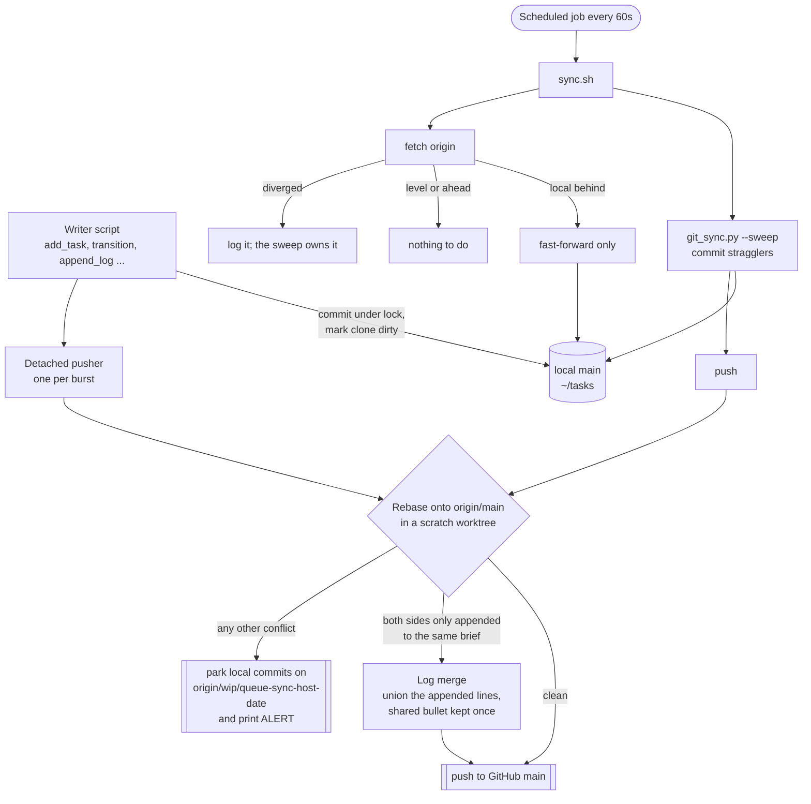

# How the work queue syncs

The queue (for example `~/tasks`) is a git repo, and GitHub `main` is the shared copy. Changes reach it in two ways:

- **On every write.** Every script that changes a brief (`add_task`, `transition`, `append_log`, `bump`, `unblock` and the rest) commits straight away under a cross-process lock and marks the clone dirty. One background pusher per clone then pushes the whole burst once.
- **Every 60 seconds, as a safety net.** A scheduled job (a LaunchAgent such as `com.example.claude-tasks-sync`, or a cron entry) runs `sync.sh`. It first runs `git_sync.py --sweep`, which commits anything no writer named and pushes it, then catches the local checkout up.

## What each outcome means

| Outcome | What happened | What to do |
|---|---|---|
| Pushed | The rebase was clean, or the two sides only appended to the same brief | Nothing |
| Parked (`ALERT`) | A real conflict, such as both sides editing the same line or frontmatter | Merge the `wip/queue-sync-*` branch into main from a worktree, then delete it |
| Diverged line in `sync.sh` log | Local and GitHub both moved and the sweep has not reconciled them yet | Nothing; the next sweep or the parked branch carries it |

`sync.sh` never rebases on its own. The checked-out `main` only ever moves by commit or fast-forward, so a conflict can never leave the checkout half-rebased.

## A queue inside another repo

A project queue such as `<repo>/projects/x/.tasks` has no repo of its own, so its writes are never committed to the host checkout. `sync_commit` returns `hosted` and `host_land.land_host_queue` ships the queue instead:

1. It takes the queue lock and lists the queue's pending paths with `git status --porcelain` in the host.
2. It fetches the host's default branch and adds a temporary worktree cut from `origin/<default>`.
3. It copies the pending files in, removes the ones deleted on disk, and records them as one commit using the write's usual message.
4. It sets the upstream of `wip/tasks-<queue-slug>` (`projects/x/.tasks` becomes `wip/tasks-projects-x`), pushes the commit there, and removes the worktree.

The host's index, HEAD and working files never change. The wip branch is rebuilt from `origin/<default>` plus everything still pending, so only this push writes it and the push forces. A file that looks like a credential stays out. Merging the wip branch is the host's own land. If a step fails, `sync_commit` returns `deferred`, the files stay on disk and the next write or sweep retries.

`check_deps.py` reports `unshipped`, one per brief, for a pending brief older than six hours. `python scripts/host_land.py <queue>` lands one by hand.
